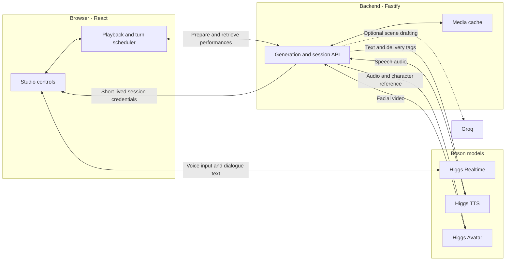
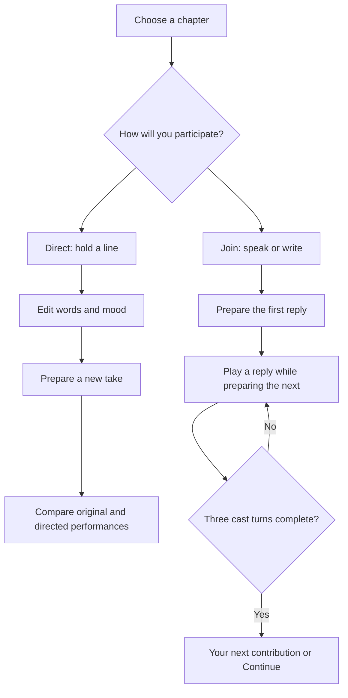

# CUT! — Tales of the Lantern

An interactive storytelling studio powered by Higgs Audio. Direct a fictional cast’s performance or join the conversation as a fourth character.

**[Watch the demo](https://drive.google.com/file/d/1OmTnYf6bVijaLQFR86TgN2de4yxSzwax/view?usp=share_link)** · [Sample performances](samples/README.md) · [Technical details](docs/CINEMATIC-PERFORMANCE.md)

## Experience

- **Watch:** explore three illustrated chapters with generated speech and facial performances.
- **Direct:** pause a line, rewrite its words, adjust its mood and compare the original with a new take.
- **Participate:** contribute by voice, text or a contextual starter. Three cast turns develop your idea before returning control to you.

## Architecture

The React studio manages playback and conversation state. Fastify coordinates speech/video generation and cached media. Higgs Realtime handles spoken input and dialogue text; Higgs TTS and Avatar produce the actors’ finished performances.



Provider keys remain on the backend. The browser receives only short-lived Realtime session credentials.

## Interaction workflow



Only one future response is prepared at a time. Joining, directing, resetting or changing chapters cancels outdated queued work. Cached replay makes no generation calls.

## Run the project

Requires **Node.js 22.18+** and **pnpm**.

```bash
pnpm install --frozen-lockfile
touch .env && chmod 600 .env
```

Add `BOSON_API_KEY` to your local, Git-ignored `.env` file. `GROQ_API_KEY` is optional and enables scene drafting. Then start the development instance:

```bash
pnpm dev
```

Open the address printed in the terminal. For a public walkthrough, use the demo video above.

Artwork and idle clips are included. Full chapter performances use an ignored local cache; on a fresh clone, choose **Scene settings → Prepare chapter** to generate them. The included [sample performances](samples/README.md) require no key. New generation uses provider credits; configure spending controls in the Boson workspace.

## Development

```bash
pnpm lint
pnpm format:check
pnpm typecheck
pnpm test
pnpm build
pnpm check:secrets
```

Tests run without provider calls. Source is organized into `apps/web`, `apps/server` and `packages/shared`.

## Scope and credits

Group views are illustrations; speaking shots and subtle idle reactions are generated video. Precise gestures, native Realtime function execution and multilingual custom-story flows are not implemented. See [capabilities and limitations](docs/CINEMATIC-PERFORMANCE.md) and [art provenance](docs/ART-PROMPTS.md). The bundled Cinzel font includes its license.
