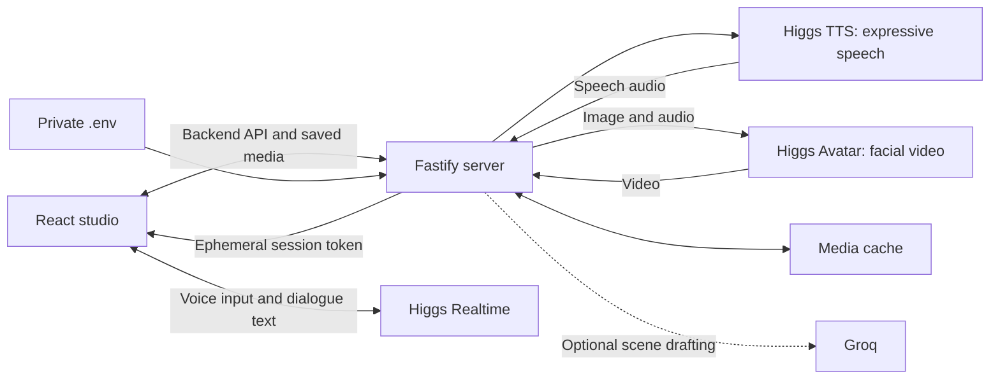
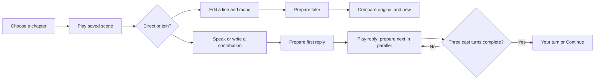

# CUT! — Tales of the Lantern

A cinematic storytelling studio: direct a fictional cast’s words and delivery, or join their conversation as a fourth character. Built with Higgs Realtime, Higgs TTS and Higgs Avatar.

**[Watch the demo](https://drive.google.com/file/d/1OmTnYf6bVijaLQFR86TgN2de4yxSzwax/view?usp=share_link)** · [Sample performances](samples/README.md) · [Implementation notes](docs/CINEMATIC-PERFORMANCE.md)

## Run locally

Requires Node.js **22.18+** and **pnpm**.

```bash
pnpm install --frozen-lockfile
cp .env.example .env
# Set BOSON_API_KEY in .env; GROQ_API_KEY is optional for scene drafting.
pnpm dev
```

For your own development instance, open the address printed by `pnpm dev`. This is not a hosted demo. Credentials stay on the backend; never put them in `VITE_` variables.

Chapter artwork and idle clips are included. Full chapter performances are stored in an ignored local cache: on a fresh clone, use **Scene settings → Prepare chapter** to generate them, or inspect the included sample videos without a key. Generation uses provider credits; cached replay does not. Configure spending controls in the Boson workspace.

## Architecture



## Workflow



Joining, directing, resetting or changing chapters discards outdated queued responses.

## Development

```bash
pnpm lint
pnpm format:check
pnpm typecheck
pnpm test
pnpm build
pnpm check:secrets
```

Tests run without provider calls. `apps/web` contains the studio, `apps/server` the provider routes and cache, and `packages/shared` the validation schemas.

## Notes

The group listening view is an illustration; speaking shots and subtle idle reactions are generated video. Precise gestures, native Realtime function execution and multilingual custom-story flows remain unimplemented. See [capabilities and limits](docs/CINEMATIC-PERFORMANCE.md) and [art provenance](docs/ART-PROMPTS.md). Font licenses are included beside the bundled fonts.
