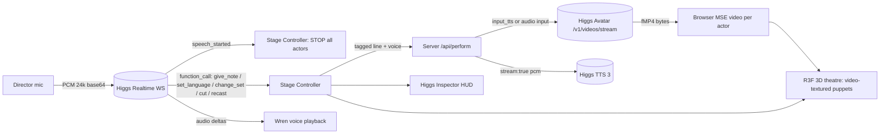

# 04 — Architecture & Repo Structure

## Plans (the spike picks one)
| Plan | Description | Choose when |
|---|---|---|
| **A (default)** | One Realtime session = Wren/Booth (listens, tool calls, short speech). Cast = TTS 3 per line → Avatar streaming per line, driven by our server. | Always viable if V-10..V-13 pass |
| B | Add LiveKit Realtime-Avatar sessions with Boson **preset** avatars as faces, one per actor | Cartoon faces fail V-10 AND concurrency/capacity pass (V-14, V-34); sacrifices custom art |
| C | A + Hot Seat (one actor live via Realtime) | V-34/V-35 pass; P2 |
| D | Stills + TTS only, Avatar on a single "hero" actor | Avatar latency fails V-11 |

## Component diagram (Plan A)


## Key flows
1. **Boot:** web → `POST /api/realtime/secret` → server mints ephemeral key via `POST /v1/realtime/client_secrets` → web opens WS with subprotocols `["realtime","bai-client-secret.<value>"]` → `session.update` (model, instructions, tools, `audio.input.turn_detection`, `audio.input.noise_reduction`, `audio.input.transcription`).
2. **Roll scene:** Stage Controller dequeues line N, requests performance; server calls Avatar stream with `ref_image` + `input_tts` (or TTS→`input`), pipes bytes to the browser; HUD logs request IDs. While N plays, pre-roll N+1.
3. **Interrupt:** `speech_started` → controller aborts fetch streams (AbortController), pauses/ends MSE, freezes puppet, drops pre-roll queue, logs ms-to-silence. Wren's reply (model-generated) handles the note.
4. **Note:** Realtime emits a `give_note` function call (`actor`, `emotion`, `style`, `pace`, `free_text`). Controller maps to a tag set via `packages/shared/tags.ts` (**only documented tags**), rewrites the line's tags, re-performs.
5. **Language switch:** `set_language` (`target`, `scope`: all|actor|second_half). Uses authored variants; otherwise V-37 path. The Higgs TTS handles the language; Avatar follows the audio.
6. **Recast:** browser records ≥5 s → server `POST /v1/audio/voices` (`ref_audio`, `ref_text`, `title`) → returns `voice_id` → future lines for that actor use `voice`.
7. **Tool result protocol (client tools):** on `response.done`, find `function_call` items with `executor:"client"`; run; send `conversation.item.create` (`function_call_output`) then `response.create`. Do **not** handle `executor:"server"` items (e.g., `web_search`).

## Degradation ladder (automatic + manual flags in `config/flags.ts`)
L0 full show → L1 avatars non-streaming (`/v1/videos` poll) → L2 avatar only for the speaking actor, others stills → L3 TTS + still-image puppets with CSS mouth flap (clearly labeled) → L4 pre-recorded real Higgs outputs from `/samples` (labeled "replay").
Never silently mock. The HUD shows the current level.

## Repo structure
```
cut/
├── README.md
├── AGENT_PROMPT.md
├── .env.example
├── .gitignore
├── package.json                 # pnpm workspaces + scripts: dev, build, spike, verify:env, lint, test
├── pnpm-workspace.yaml
├── tsconfig.base.json
├── apps/
│   ├── web/                     # Vite + React + TypeScript + React Three Fiber
│   │   ├── src/
│   │   │   ├── main.tsx
│   │   │   ├── app/             # shell, routes (/, /stage, /judge), error boundary
│   │   │   ├── stage/           # 3D theatre: Stage.tsx, Puppet.tsx, Curtain.tsx, Rig.tsx (camera), Weather.tsx
│   │   │   ├── audio/           # mic capture (AudioWorklet), PCM playback, echo/noise config
│   │   │   ├── realtime/        # WS client, event types, tool dispatcher, session config
│   │   │   ├── performance/     # per-actor player: MSE pipeline, abort, pre-roll queue
│   │   │   ├── hud/             # Higgs Inspector, caption bar, latency meter
│   │   │   ├── state/           # zustand store + stage state machine
│   │   │   └── styles/
│   │   └── public/              # character art, fonts, textures
│   └── server/                  # Fastify (or Hono) + TypeScript
│       └── src/
│           ├── index.ts
│           ├── routes/          # realtime-secret, perform, voices, health
│           ├── boson/           # typed clients: tts.ts, avatar.ts, voices.ts, realtime.ts
│           ├── guards/          # rate limit, cost caps, consent check
│           └── cache/           # disk cache of REAL generated clips keyed by hash
├── packages/
│   └── shared/                  # zod schemas: Scene, Line, Tool args; tags.ts (documented tags only)
├── content/
│   ├── scenes/lighthouse.json
│   └── characters/{odile,rocco,pim}/{ref.png,cutout.png,palette.json,voice.json}
├── scripts/
│   ├── verify-env.ts            # never prints the key
│   └── spike/                   # one script per V-xx check, writes to /spike-results
├── spike-results/               # committed evidence (small)
├── samples/                     # example inputs/outputs for judges (real outputs)
├── docs/                        # this folder
└── .github/workflows/ci.yml     # lint + typecheck + unit tests (no network)
```

## Tech choices (and why)
- **TypeScript everywhere**; zod at every boundary (docs' event shapes drift → validate).
- **Vite + React + R3F + drei + postprocessing**; **zustand** for state; **GSAP** or spring for camera moves; **AudioWorklet** for mic PCM at 24 kHz.
- **Fastify** server: tiny, typed, streams easily; proxies Boson REST so the key never reaches the browser and CORS is not our problem (V-13 / assumption 7).
- **MSE** for fMP4 playback; fallback to blob URL after completion.
- **No LiveKit in Plan A.** LiveKit Cloud only if Plan B.
- Tests: Vitest for pure logic (tag mapper, scene parser, state machine). No network in CI.

## Hard constraints
- Use only documented endpoints/fields. Anything else → UNVERIFIED + spike test before use.
- Tags come only from the documented list; unknown tags are rejected by `tags.ts`.
- TTS `timestamps:true` cannot be combined with `stream:true` (docs: 400). Captions: run a separate non-stream timestamp call only for en/zh/es short lines, or use line timing.
- Avatar `input_tts.input` ≤5,000 chars; `input` audio ≤60 s; image ≤10 MB inline.
